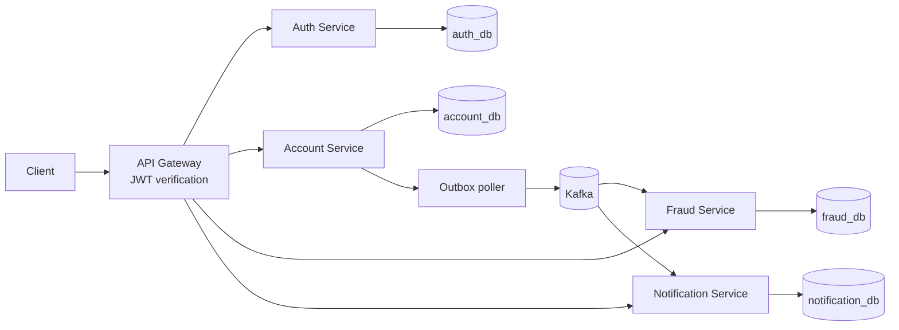

# NexBank

NexBank is a Java 21 and Spring Boot microservices backend starter for secure banking workflows. It includes a signed-token auth service, API gateway, account and ledger service, Kafka outbox publisher, fraud review service, and notification consumer. It is a learning and portfolio project; the current implementation is a substantial starter and still needs the hardening items listed below before it represents a production banking system.

## Architecture



Each service has its own database schema/database, Flyway migration, Dockerfile, and package areas for web, service, repository, entity, DTO, config, security, and exceptions as applicable. Services do not query another service's database.

## Technology

- Java 21, Maven, Spring Boot, Spring Cloud Gateway
- Spring Security BCrypt, signed JWT, bean validation, Spring Data JPA
- PostgreSQL 16 and Flyway; `BigDecimal`/`DECIMAL(19,2)` for money
- Kafka 3.8, transactional outbox, idempotent event consumers
- Redis 7 backs gateway rate limits, login refresh-token revocation, and fraud velocity counters
- JUnit 5, Mockito, Spring Boot test; Docker Compose

## Run locally

Install Java 21 and Docker Desktop. Copy `.env.example` to `.env` and replace `DB_PASSWORD` and `JWT_SECRET` with strong local values. Start the stack with:

```powershell
docker compose up --build
```

The gateway listens at `http://localhost:8080`. Auth endpoints are `POST /api/auth/register`, `POST /api/auth/login`, `POST /api/auth/refresh`, and authenticated `POST /api/auth/logout`. Login returns a 15-minute access token and a rotating 30-day refresh token. Send the access token as `Authorization: Bearer <token>` to protected routes. Account routes include `POST /api/accounts`, `GET /api/accounts/{id}`, `POST /api/accounts/{id}/deposit`, `POST /api/accounts/{id}/withdraw`, `POST /api/transfers` (requires an `Idempotency-Key` header), and paged `GET /api/accounts/{id}/transactions?page=0&size=20`. Customer notifications are available at `GET /api/notifications`. Fraud review routes are under `/api/fraud/alerts`.

To bootstrap the first administrator, set optional `ADMIN_EMAIL` and a unique `ADMIN_PASSWORD` (at least 12 characters) in `.env` before starting the auth service. Admin endpoints under `/api/admin/users` create staff and change roles; these actions are written to an auth database audit table. New public signups always receive `CUSTOMER`.

Example registration:

```json
{"email":"customer@example.com","password":"use-a-long-unique-password"}
```

Account creation takes an empty JSON object; the owner is taken from the verified token. A deposit body is `{"amount":500.00}`. A transfer body is `{"fromAccountId":"<uuid>","toAccountId":"<uuid>","amount":125.00}`.

Open Swagger UI through the gateway at `http://localhost:8080/swagger-ui/index.html`. The selector lists the five service API descriptions; service docs are routed through the gateway rather than exposing service ports.

## Build and tests

Use the Maven Wrapper to run the build and tests:

```powershell
.\mvnw.cmd verify
```

In IntelliJ, set **File → Project Structure → Project SDK** and **Settings → Build Tools → Maven → Runner → JRE** to a Java 21 JDK. Check `mvnw.cmd -version` reports Java 21 before using the wrapper.

The unit suite covers auth registration/refresh/logout, account transfer/ledger rules and Redis idempotency cache behavior, fraud rules and freeze events, AI-provider fallback, outbox delivery, notification deduplication, and gateway token/rate-limit rules. Four PostgreSQL Testcontainers tests cover rollback, idempotency, 50 concurrent transfers, and opposite-direction transfers; Docker Desktop must be running for those tests. The full Kafka/Redis integration matrix is still outstanding.

The root Maven build enforces at least 70% JaCoCo line coverage for each top-level service class. The latest local report showed approximately 91% across service classes. The local full-reactor verification used the installed Java 17 runtime with a temporary compiler release override because this workspace does not have JDK 21; use Java 21 for the official project build and GitHub CI.

## Current completion status

- Implemented and locally verified: registration/login/rotating refresh/logout blacklist; gateway JWT verification and Redis rate limits; customer/teller/compliance/admin role rules and ownership checks; account deposits, withdrawals, ledger history, and locked transactional transfers; 24-hour Redis idempotency result cache with PostgreSQL key serialization; cached account reads with mutation/fraud-freeze eviction; Kafka outboxes, consumers, retries and DLTs; multi-signal fraud checks and optional masked-data AI explanation; notification/audit log entries; Swagger UI; Docker Compose; GitHub CI, GHCR image publishing, and a 70% JaCoCo service-class gate.
- Remaining to prove or configure: run the four PostgreSQL Testcontainers tests with Docker Desktop, add Kafka/Redis integration tests, publish and confirm green GitHub Actions runs, and configure a real VM/domain/secrets for HTTPS deployment and a demo video. No production URL or video is claimed yet.
- NexBank is an API backend, not a web banking screen. Use Swagger UI, PowerShell, or Postman at `http://localhost:8080`.

## Key design choices

- Each transfer locks both account rows in stable ID order and commits debit, credit, ledger rows, transfer row, and outbox event in one database transaction.
- A unique idempotency key stores one transfer result. Reusing the key with a different request is rejected.
- The outbox poller publishes committed transfer events to Kafka and marks them published only after broker acknowledgement. Consumers retain processed event IDs for duplicate suppression.
- Fraud rules decide whether a transfer needs review. The optional AI explanation adapter is non-authoritative and sends only masked rule context; the service falls back to the rule-based result if no AI configuration is supplied or the provider fails.
- The gateway verifies token signatures and expiry, then replaces user identity headers before forwarding.

## Resume-ready summary

**NexBank — Java 21, Spring Boot, PostgreSQL, Kafka, Redis, Docker**

- Built a five-service banking backend with JWT authentication, four-role access control, account ownership checks, and audited staff administration.
- Implemented ACID-safe transfers with ordered row locks, ledger entries, a transactional outbox, PostgreSQL idempotency, and a 24-hour Redis retry cache.
- Added Kafka fraud and notification consumers with deduplication, bounded retries/DLTs, multi-signal fraud rules, and an optional masked-input LLM explanation fallback.
- Added JUnit/Mockito tests and a JaCoCo gate requiring 70% line coverage per service class; latest local unit-test coverage was approximately 91%.

**Challenge to discuss:** A client can time out after a transfer commits and retry. NexBank serializes the idempotency key in PostgreSQL, stores the completed transfer reference in Redis for 24 hours after commit, and keeps the database unique constraint as the durable source of truth. This prevents a retry from moving the money twice while preserving the original result.

## Production hardening still required

- Add retention/cleanup policies for idempotency and processed-event records.
- Add Kafka/Redis Testcontainers integration coverage and run the PostgreSQL concurrency tests on a Docker-enabled runner. Unit tests do not replace these integration checks.
- Confirm the GitHub Actions CI and GHCR image workflow after push, then configure deployment secrets, HTTPS, backups, monitoring, and operational runbooks for a real host. The current Compose stack is for local development and is not a production deployment.
- The optional AI explanation adapter uses only masked rule context and is non-authoritative. Email delivery and external AI-provider behavior still need end-to-end validation.
