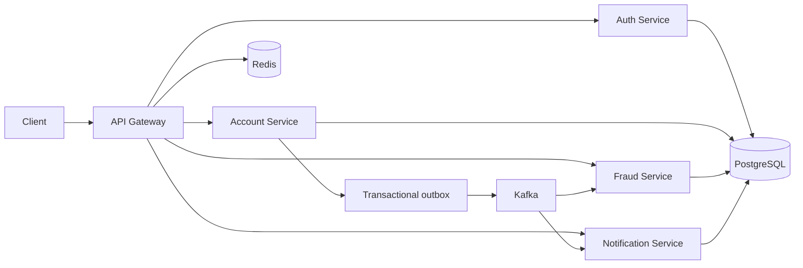

# NexBank

NexBank is a Java 21 banking backend built with Spring Boot. It is split into five services and demonstrates authentication, account and transfer operations, fraud review, and event-driven notifications.

This is a learning project. It is not intended to process real customer funds or to be used as a production banking system.

## Services

| Service | Responsibility |
| --- | --- |
| API Gateway | Routes requests, validates JWTs, and applies rate limits |
| Auth Service | Registration, login, refresh tokens, logout, and staff roles |
| Account Service | Accounts, deposits, withdrawals, transfers, and ledger history |
| Fraud Service | Reviews transfer events and records fraud alerts |
| Notification Service | Consumes events and records customer notifications |

PostgreSQL stores each service's data in a separate database. Kafka carries service events, and Redis supports rate limiting, token revocation, fraud counters, and account caching.



## Stack

- Java 21, Maven, Spring Boot, Spring Cloud Gateway
- Spring Security, BCrypt, JWT, Spring Data JPA, and Flyway
- PostgreSQL 16, Kafka 3.8, and Redis 7
- JUnit 5, Mockito, JaCoCo, Docker Compose, and GitHub Actions

## Run locally

Install JDK 21 and Docker Desktop. In PowerShell, copy the sample environment file and set a local database password and a JWT secret of at least 32 characters:

```powershell
Copy-Item .env.example .env
```

Edit `.env`, then start the services from the project root:

```powershell
docker compose up --build -d
docker compose ps
```

The API Gateway is available at `http://localhost:8080`. Swagger UI is at `http://localhost:8080/swagger-ui/index.html`.

To stop the services, run `docker compose down`. Add `-v` only when you also want to delete the local database and Redis volumes.

To create the first administrator, set `ADMIN_EMAIL` and a unique `ADMIN_PASSWORD` of at least 12 characters in `.env` before the first start. Public registrations receive the `CUSTOMER` role. Admin endpoints can create staff users and change roles; these changes are recorded in the auth database audit table.

## API overview

Authentication routes:

- `POST /api/auth/register`
- `POST /api/auth/login`
- `POST /api/auth/refresh`
- `POST /api/auth/logout` (authenticated)

Account routes include `POST /api/accounts`, `GET /api/accounts/{id}`, deposit and withdrawal routes under `/api/accounts/{id}`, `POST /api/transfers`, and paged transaction history at `/api/accounts/{id}/transactions`. Transfers require an `Idempotency-Key` header. Customers can access their own accounts; staff access is controlled by role.

Fraud alerts are available under `/api/fraud/alerts`; customer notifications are available at `GET /api/notifications`.

Example registration body:

```json
{"email":"customer@example.com","password":"use-a-long-unique-password"}
```

Account creation uses an empty JSON body. A deposit body is `{"amount":500.00}`. A transfer body is `{"fromAccountId":"<uuid>","toAccountId":"<uuid>","amount":125.00}`.

## Build and tests

Run the Maven verification from the project root:

```powershell
.\mvnw.cmd verify
```

Set the IntelliJ Project SDK and Maven Runner JRE to JDK 21. The root build requires at least 70% JaCoCo line coverage for each top-level service class.

The test suite covers auth flows, account and ledger rules, idempotency, gateway security, fraud handling, outbox behavior, and notification deduplication. Four PostgreSQL Testcontainers tests exercise rollback, duplicate requests, concurrent transfers, and opposing transfers; Docker Desktop must be running for these tests. GitHub Actions runs `verify` on Java 21 for pushes and pull requests.

## Transfer design

Transfers lock both account rows in a stable order. The debit, credit, ledger entries, transfer record, and outbox event are committed together. A database uniqueness constraint protects each idempotency key; Redis caches the completed result for 24 hours. Reusing a key with a different request is rejected. The outbox publishes only committed events, and consumers suppress duplicate event IDs.

Fraud rules determine whether a transfer needs review. The optional AI adapter can explain a rule result using masked context; it does not make the fraud decision. If the provider is unavailable or not configured, the rule result is used without an AI explanation.

## Deployment

`docker-compose.prod.yml`, `Caddyfile`, and `.github/workflows/deploy.yml` provide a starting point for deploying to a VM with HTTPS. The workflow is disabled by default. It requires a VM, a domain pointed to that VM, and the repository variable and secrets named in the workflow; do not commit real environment files or credentials.

No public deployment URL is configured for this repository. The local Compose setup is intended for development and demonstration, not production banking.
